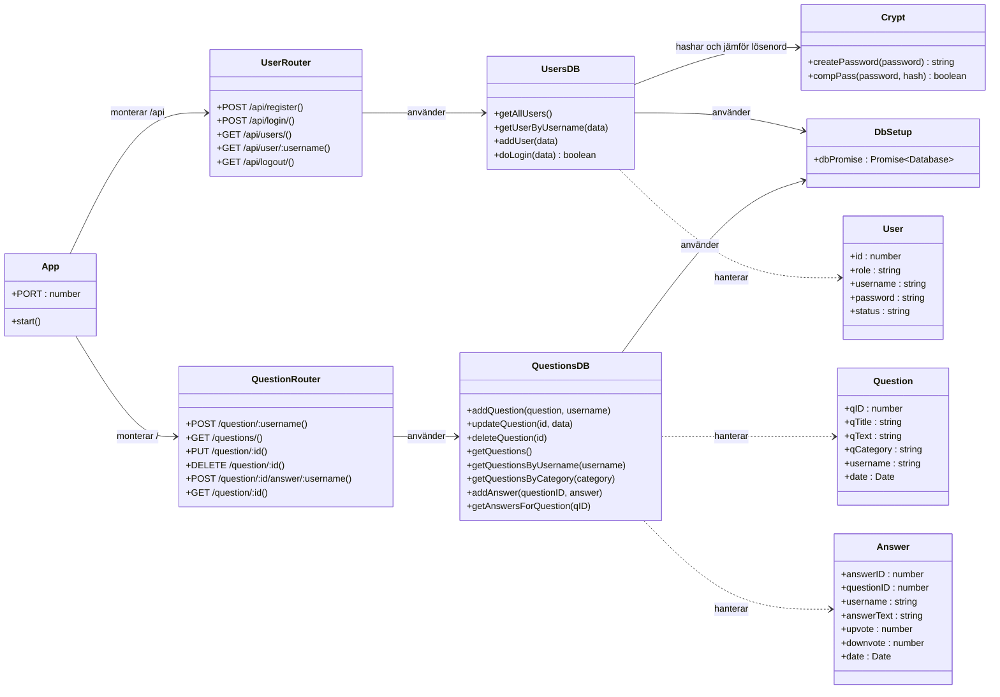
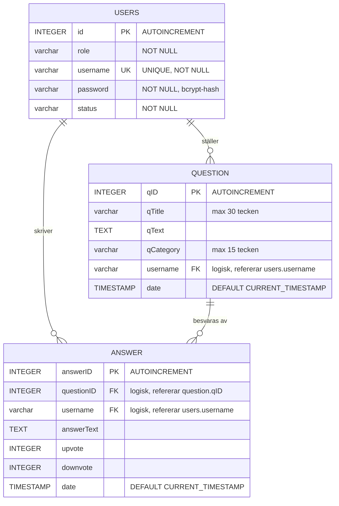

# DynamiskaApplProject

Ett enkelt frågor-och-svar-forum (Q&A) byggt med Node.js, Express och SQLite som projektarbete i kursen Dynamiska webbapplikationer (2021).

Användare kan registrera sig, logga in och ställa frågor i olika kategorier. Frågor visas för alla användare och kan uppdateras via API:et.

## Innehåll

- [Teknikstack](#teknikstack)
- [Kom igång](#kom-igång)
- [Projektstruktur](#projektstruktur)
- [API-översikt](#api-översikt)
- [Datamodell](#datamodell)
- [UML-diagram](#uml-diagram)
- [ER-diagram](#er-diagram)
- [Kända begränsningar](#kända-begränsningar)

## Teknikstack

| Del | Teknik |
| --- | --- |
| Server | Node.js, Express 4 |
| Databas | SQLite (`sqlite`, `sqlite3`) |
| Lösenordshantering | bcrypt |
| Sessioner | express-session |
| Frontend | HTML, CSS, jQuery och Vue (statiska filer i `public/`) |

## Kom igång

Krav: Node.js med npm.

```bash
npm install
npm start          # startar servern på http://localhost:3055
npm run run        # startar med nodemon för utveckling
```

Porten kan ändras med miljövariabeln `PORT`.

Databasen finns i filen `thedatabase.sqlite`. Tabellerna definieras i `sql.sql`.

Exempelanrop för att testa API:et finns i `request.rest` (används med t.ex. REST Client-tillägget i VS Code).

## Projektstruktur

```
.
├── index.js            # Startar Express-appen och kopplar ihop routes
├── routes/
│   ├── users.js        # Registrering, inloggning, användare och utloggning
│   └── qa.js           # Frågor och svar
├── database/
│   ├── dbSetup.js      # Öppnar anslutningen till SQLite
│   ├── usersdb.js      # Databasfunktioner för användare
│   └── qadb.js         # Databasfunktioner för frågor och svar
├── crypt.js            # Hashning och jämförelse av lösenord (bcrypt)
├── random.js           # Hjälpfil för Vue-kod (inte kopplad till servern)
├── public/             # Statiska HTML-, CSS- och JavaScript-filer
├── sql.sql             # Skript som skapar tabellerna
└── request.rest        # Exempelanrop mot API:et
```

## API-översikt

Användarrouten är monterad på `/api/` och frågerouten på `/`.

### Användare (`/api`)

| Metod | Sökväg | Beskrivning |
| --- | --- | --- |
| POST | `/api/register` | Registrerar en användare (`role`, `username`, `password`). |
| POST | `/api/login/` | Loggar in och returnerar användaruppgifterna. |
| GET | `/api/users/` | Hämtar alla användare. |
| GET | `/api/user/:username` | Hämtar en användare och omdirigerar till startsidan. |
| GET | `/api/logout/` | Avslutar sessionen. |
| GET | `/api/home/` | Omdirigerar till `home.html`. |

### Frågor och svar

| Metod | Sökväg | Beskrivning |
| --- | --- | --- |
| POST | `/question/:username` | Ställer en fråga (`qTitle`, `qText`, `qCategory`). |
| GET | `/questions/` | Hämtar alla frågor. |
| PUT | `/question/:id` | Uppdaterar en fråga. |
| DELETE | `/question/:id` | Tar bort en fråga. |
| POST | `/question/:id/answer/:username` | Lägger till ett svar på en fråga (`answerText`). |
| GET | `/question/:id` | Hämtar svar kopplade till en fråga. |

## Datamodell

Tre tabeller används:

- **users**: användare med roll, unikt användarnamn och bcrypt-hashat lösenord. Roller som används i projektet är `Super Admin`, `Consumer` och `Contributor`.
- **question**: frågor med titel, text, kategori, författare och datum.
- **answer**: svar kopplade till en fråga och en författare, med röster (`upvote`, `downvote`) och datum.

Kopplingarna sker via kolumnerna `username` och `questionID`. Tabellerna har inga främmande nycklar (`FOREIGN KEY`) definierade i `sql.sql`.

## UML-diagram

Klassdiagrammet visar hur serverns delar hänger ihop: routes anropar databasmodulerna, som i sin tur använder den delade databasanslutningen och lösenordsmodulen.



## ER-diagram



Notera att relationerna är logiska. Databasen har inga främmande nycklar, så sambandet mellan tabellerna upprätthålls endast av applikationskoden.

## Kända begränsningar

Detta är ett skolprojekt och några saker är inte färdiga:

- Sessionens hemlighet (`secret`) ligger hårdkodad i `routes/users.js`.
- `deleteQuestion` i `database/qadb.js` använder ogiltig SQL (`DELETE *`).
- Tabellen `answer` har kolumner för röster, men det finns inga endpoints för att rösta.
- `getAnswersForQuestion` returnerar frågor och svar via en join, men funktionen tar emot ett `questionID` som inte används.
- Rollnamnet för bidragsgivare skrivs olika på olika ställen (`Contributor` och `contributor`).
- `status` i `sql.sql` har stavfelet `varcahr`. SQLite accepterar det, men det bör rättas.
- Felhanteringen returnerar ofta statuskod 200 även vid fel, och `res.sendStatus(404).send(...)` vid felaktig inloggning ger inte rätt svar.
